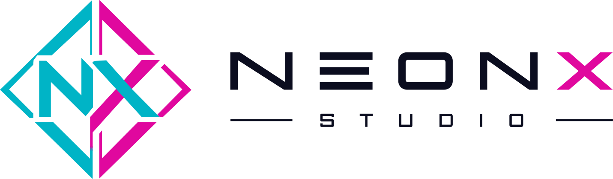
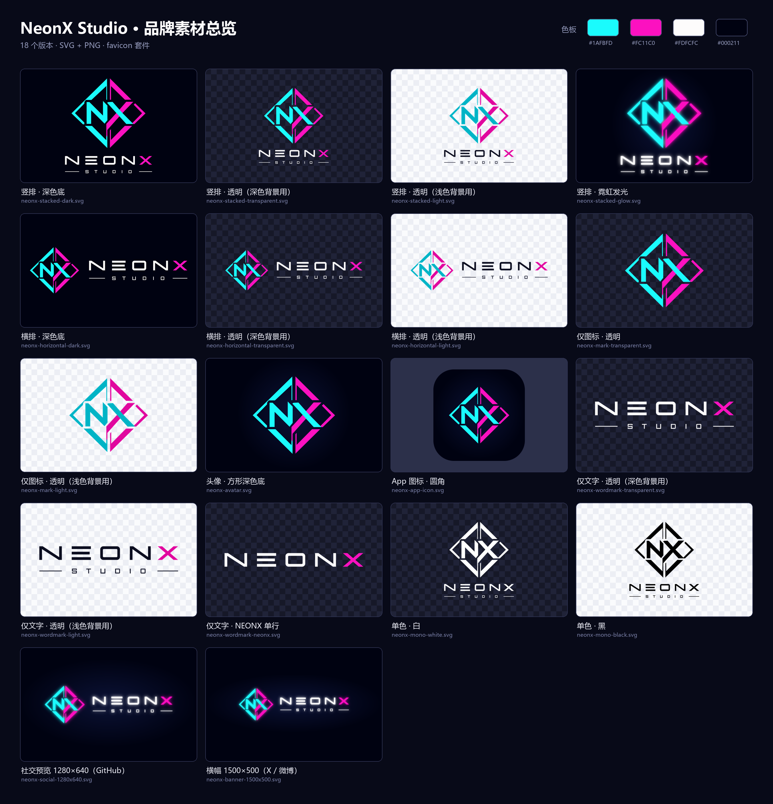

  <picture>
    <source media="(prefers-color-scheme: dark)" srcset="assets/brand/web/neonx-lockup.svg">
    
  </picture>

游戏 × 人工智能的未来 · <a href="https://neonx.top/">neonx.top</a>

# neonx.top

NeonX Studio 官方网站源码，纯静态页面（`index.html`），无需构建。

## 品牌素材

所有 Logo 素材位于 [`assets/brand/`](assets/brand/)，均提供 SVG 与高清 PNG：

| 目录 | 内容 |
| --- | --- |
| `svg/` · `png/` | 竖排、横排、仅图标、仅文字、单色、霓虹发光、头像、App 图标、社交预览（1280×640）、横幅（1500×500） |
| `web/` | 无留白的网页用 SVG（图标、NEONX 字标、横排组合） |
| `favicon/` | `favicon.ico` / `favicon.svg` / `apple-touch-icon.png` / 16–512 PNG |
| `neonx-logo-master.svg` | 母版矢量文件 |

### 色板

| 名称 | 色值 |
| --- | --- |
| Neon Cyan | `#1AFBFD` |
| Neon Pink | `#FC11C0` |
| White | `#FDFCFC` |
| Midnight | `#000211` |

浅色背景请使用带 `-light` 后缀的版本（青、粉已加深以保证对比度）。
